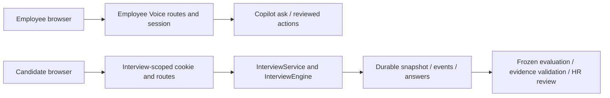
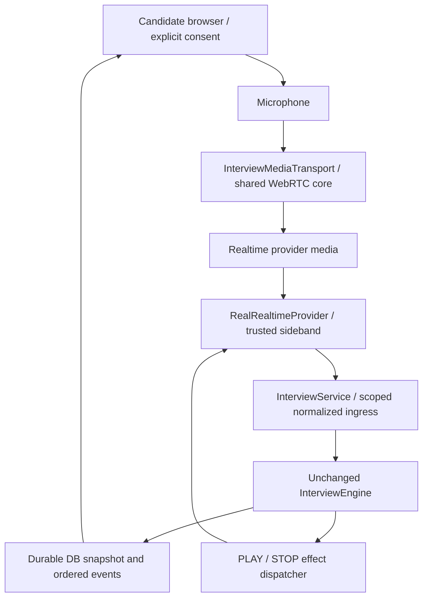

# Phase 5A — Realtime integration readiness

Status: **PHASE 5A READY FOR IMPLEMENTATION** — a gated Phase 5B plan, not a
declaration that live audio is already implemented or safe to activate.

Analysis date: 2026-11-01. Scope: repository inspection, official OpenAI
documentation verification, implementation plan and source-protection evidence.
No production source, runtime configuration, dependency, migration, model or
training artifact is changed in Phase 5A. No API key was requested, displayed,
configured or used; no provider session, microphone or WebRTC connection started.

## 1. Existing architecture discovered

There are three distinct speech paths:

1. Employee Realtime Voice: `useVoiceProvider` selects `useVoiceCopilot`; the
   browser owns microphone, RTCPeerConnection, a remote audio element and the
   `oai-events` channel. Final transcripts go through employee `/api/voice` routes
   into the existing Copilot authorization/action pipeline. It is not an
   interview transport module that can simply be mounted on a candidate page.
2. Local Voice: browser AudioWorklet/VAD → bounded PCM WAV → authenticated local
   STT → employee Copilot turn → local Piper TTS → finite audio playback. Worker
   traffic is loopback-only and has an independent worker bearer token.
3. Browser dictation: SpeechRecognition → editable chat input. It has a script-
   dominance language filter and is separate from both voice transports.

The interview is a fourth **domain**, not a reason for a second WebRTC stack.
Its existing mock provider, engine, durable service, candidate cookie, browser
state cache, ordered replay and report verifier form the integration boundary.

## 2. Exact inspected files and important anchors

Paths are repository-relative. Anchors identify the inspected implementation,
not proposed new functionality. SHA-256 fingerprints are in the verification JSON.

| File | Relevant current behavior |
| --- | --- |
| `apps/hr-web/src/features/copilot/useVoiceCopilot.ts:117` | Ephemeral SDP exchange with `/v1/realtime/calls`; returns only answer text |
| Same file `:194`, `:215`, `:260` | Data-channel send, trusted speech request, cancellation/cleanup |
| Same file `:337`, `:411`, `:455` | Transcript → employee turn, credential warming, start |
| Same file `:490`, `:551`, `:578`, `:629` | Peer, remote audio, channel, response.done UI transition |
| `apps/hr-web/src/features/copilot/useVoiceProvider.ts` | Explicit local/OpenAI employee provider selection |
| `apps/hr-web/src/features/copilot/PersistentVoiceCopilot.tsx:160` | Existing hidden remote audio element and employee UI |
| `apps/hr-web/src/features/copilot/useVoiceDictation.ts:41` | Script-dominance language gate |
| `apps/hr-web/src/features/copilot/useLocalVoiceCopilot.ts:26` | Generation fencing, finite TTS onended, local STT/turn/TTS orchestration |
| `apps/hr-web/src/features/copilot/localVoiceAudio.ts` | Loopback guard, playback error distinction, PCM conversion/capture cleanup |
| `apps/hr-web/src/features/copilot/localVoiceVad.ts` | Acoustic endpointing and bounded utterance capture |
| `services/hr-api/src/routes/voice.ts:60` | Entire router requires employee authentication |
| Same file `:526`, `:567`, `:634` | Prepare, SDP connect/fallback, employee transcript turn |
| `services/hr-api/src/voice/realtime.ts:31` | Server-only SDK/config, tools=[], manual response creation, 60-second client secret |
| `services/hr-api/src/voice/session.ts:12`, `:80`, `:97` | 20-minute in-memory employee-owned sessions and confirmation cache |
| `services/hr-api/src/voice/local.ts` | Loopback worker authorization, admission queue, 30-second/500-character limits |
| `services/hr-api/src/voice/localQueue.ts` | Bounded local audio queue |
| `server/local-voice/worker.py`, `server/local-voice/stt_runtime.py:101` | Resident whisper.cpp automatic-language STT and Piper voices |
| `packages/contracts/src/voice.ts` | Mixed-language STT vocabulary; employee turn/context schemas |
| `services/hr-api/src/env.ts:43` | Employee voice switches; interview mock switch; server-only model defaults |
| `packages/contracts/src/aiInterview.ts:184` | Provider-neutral media observations |
| `services/hr-api/src/aiInterviewer/providers.ts` | subscribe/play/stop interface and deterministic MockRealtimeProvider |
| `services/hr-api/src/aiInterviewer/harness.ts:10` | Existing observation → engine command mapping |
| `services/hr-api/src/aiInterviewer/mockRuntime.ts` | Closed, development-only observation bridge |
| `services/hr-api/src/aiInterviewer/engine.ts:125`, `:325`, `:351`, `:361` | Timer start, playback, interruption, speech/finalization semantics |
| `services/hr-api/src/aiInterviewer/service.ts:41`, `:124`, `:155`, `:254` | Effects, restart recovery, transaction/receipt boundary, candidate-safe projection |
| `services/hr-api/src/aiInterviewer/authorization.ts`, `repository.ts`, `recovery.ts` | Interview-bound credential, locks/idempotency, freeze at last durable observation |
| `services/hr-api/src/aiInterviewer/routes.ts:85` | Mock-only capability; START fails closed without mock runtime |
| `services/hr-api/src/aiInterviewer/runtime.ts` | Durable evaluation jobs, timer/answer processing and heartbeat scan |
| `apps/hr-web/src/features/aiInterviewer/client.ts`, `session.ts`, `useInterviewSession.ts` | Candidate-only requests, cache identity/version protection, polling/replay |
| `apps/hr-web/src/pages/AiInterviewPage.tsx`, `features/aiInterviewer/InterviewTimer.tsx`, `MockControls.tsx` | Standalone room, authoritative display and DEV-only controls |
| `apps/hr-web/src/app/App.tsx` | Candidate entry bypasses employee AuthProvider |
| `services/hr-api/src/aiInterviewer/evaluationInput.ts`, `report.ts`, `reportService.ts` | Frozen inputs, exact evidence, versioned jobs/review |
| `packages/contracts/src/aiInterviewPersistence.ts`, `aiInterviewUi.ts`, `aiInterviewReport.ts` | Candidate, replay, consent and report contracts |
| `services/hr-api/src/db/schema.ts:1397`, `:1408`, `:1425` | JSON consent, pending effects and metadata/event storage already available |
| `services/hr-api/src/index.ts:98` | Existing candidate/staff router assembly and maintenance |

Installed package inspection: `openai` is **7.20.0**. Its
`openai/realtime/websocket` entry point supports a server-side `callID` connection
using the native WebSocket runtime. `openai/realtime/ws` requires optional `ws`,
which is not installed. Do not import the latter or install it in Phase 5A.
Native SDK/socket behavior still needs an offline fake-socket test in Phase 5B.

## 3. Reuse classification

| Component | Classification | Reason / boundary |
| --- | --- | --- |
| Peer/transceiver/microphone constraints and parallel SDP setup | REUSE | Extract a configurable, authorization-free transport from the current hook; retain one implementation |
| Peer/channel/track cleanup and late getUserMedia resolution cleanup | REUSE | Preserve ownership; add generation checks to every asynchronous callback |
| Remote audio attachment | EXTEND | Surface play rejection, stalled sink and per-response playback observations; no swallowed errors |
| Existing browser eventJson | EXTEND | Replace loose cast with closed validation, IDs, limits and connection ownership |
| SDK call/client-secret plumbing | EXTEND | Shared server-only primitive accepting explicit config; retain call identity and sanitized failure metadata |
| Employee useVoiceCopilot orchestration | ISOLATE | Copilot turns, response-language choice, navigation and confirmations stay employee-only |
| Employee `/voice/*` routes and VoiceSession | DO NOT REUSE | requireAuth/userId session and Copilot execution are the wrong candidate authority/lifetime |
| Voice UI/result/context contracts | DO NOT REUSE | Employee identifiers, actions and 500-character limits do not describe interview answers |
| Dictation language filter and normalized text echo/dedupe | DO NOT REUSE | Can reject valid mixed text or suppress a legitimate repeated answer/quote |
| Local PCM, acoustic VAD, finite-player error handling | REUSE selectively | Pure media techniques only; preserve loopback/size guards and do not import employee endpoints |
| Local STT/TTS orchestration and 30-second capture cap | ISOLATE | Existing employee demo pipeline is not a production interview adapter or long-answer fallback |
| MockRealtimeProvider / MockEvaluator | REUSE unchanged | Deterministic offline development and regression path remains available |
| Interview provider interface / media contracts | EXTEND outside engine | Lifecycle/correlation envelope around existing normalized observations |
| InterviewService / locks / receipts / replay / recovery | REUSE | Remain the only durable authority; new ingress strengthens source validation |
| Phase 3 room/cache/timer | EXTEND | Add explicit real media capability and feedback; never a browser interview reducer |
| Phase 4 input/verifier/report/review | REUSE unchanged | A later evaluator cannot bypass this acceptance path |
| VOICE_DEV_MOCK | ISOLATE | Employee adapter flag; preserve separate AI_INTERVIEW_DEV_MOCK DEV-only policy |

The monolithic employee hook cannot be reused wholesale safely. That proves a
need for extraction/adapters, not for a separate hand-written WebRTC stack.

## 4. Current WebRTC flow

`/voice/config` selects the employee provider. The enabled OpenAI hook can warm
`/voice/prepare` after the layout settles, even before the microphone click.
Start overlaps credential preparation, SDP creation and microphone permission.
It creates one sendrecv audio transceiver without a microphone track, opens
`oai-events`, then attaches the track after permission. Activation waits for track,
transport and open channel. Remote tracks are attached to an audio element.

The hook sends server VAD settings (0.6 threshold, 450 ms prefix, 700 ms silence),
create_response=false and interrupt_response=true. Final transcriptions go to
the authenticated employee backend. Backend results are rendered with explicit
response.create, conversation=none and supplied text, not autonomous HR tools.

Current weaknesses for an interview: audio.play rejection is swallowed; channel
close/error handlers are empty; response.done ends the speaking UI; callbacks
mainly check a shared stopped flag rather than a persisted media generation.
Existing employee reconnect creates a new employee voice session, not recovery
of an interview's durable question/turn. These behaviors must not be copied as
interview semantics.

## 5. Current credential flow and proposed choice

Existing server `getClient` reads OPENAI_API_KEY only on the server and configures
a 10-second setup timeout with no SDK automatic retries. `/voice/prepare` can
return a 60-second client secret to an authenticated employee. `/voice/connect`
accepts SDP and supports unified setup, with an upstream-5xx ephemeral fallback.
The browser uses only that returned clientSecret for its direct SDP request.
No permanent key reference was found in browser source. This is a static boundary
finding, not a live credential/call test. Generic String(error) logging in the
legacy helper is not a proof of redaction; the interview adapter must use safe
codes/status only and never log SDP, secrets, headers, protocols or error bodies.

The official Realtime WebRTC flow supports server-mediated unified SDP and
ephemeral credentials. **Choose unified SDP for the first interview adapter**:
keep configuration and call creation on the trusted server, return SDP plus an
opaque application media-generation id, and retain the provider call id server-
side. No provider credential needs to reach the candidate in this path.
[Official OpenAI WebRTC documentation](https://developers.openai.com/api/docs/guides/voice-webrtc?voice-api=realtime).

A short TTL is not interview authorization. Official client-secret documentation
says a secret may create multiple sessions until expiry and client connections
can override its attached configuration. Therefore the employee ephemeral
fallback is **not** an interview-scoped security primitive. No automatic unified
→ ephemeral fallback for interviews; a future optional path needs verified
server binding and its own gate. Expiry of a secret is not termination of an
already-created session.
[Create client secret](https://developers.openai.com/api/reference/resources/realtime/subresources/client_secrets/methods/create).

## 6. Candidate security design

Keep the existing HttpOnly `ai_interview_session` cookie, path
`/api/ai-interview`, same-site/secure policy, exact Origin checks, no-store,
no-referrer, hashed credentials, expiry, revocation and one-interview binding.
An employee cookie alone must grant no candidate capability, and vice versa.

Proposed endpoints, **not implemented**:

- POST `/api/ai-interview/realtime/connect`: interviewId, expectedVersion,
  requestId and bounded SDP. Validate the candidate inside the locked interview
  transaction, accepted audio consent, frozen plan, lifecycle and current media
  generation before reserving setup. Revalidate after external setup before
  attaching; revoke/hang up if authorization changed while waiting.
- POST `/api/ai-interview/realtime/feedback`: tightly allowlisted sink-ready,
  playback-blocked, heartbeat or explicit close feedback with generation and
  correlation ids. No arbitrary engine command, transcript or score fields.
- POST `/api/ai-interview/realtime/disconnect`: close this generation and pause
  through the existing service if active. Idempotent and scoped.

The existing candidate `/commands` may accept typed final transcripts and speech
observations for Mock. For a **real-bound attempt**, browser-origin speech/final
transcript/playback observations must be denied; only backend-verified provider
ingress supplies them. Consent/start/pause/resume/cancel remain scoped candidate
intent. A client cannot downgrade its real attempt to Mock in a request.

Never mount employee Voice routes in the candidate app, mint hr_session, pass
VoiceUiContext, or invoke /copilot/ask, /copilot/do or MCP. No tools or hiring
authority are included in provider session configuration. Candidate feedback
cannot create a provider principal or choose an application/candidate identity.

The current consent UI expressly describes simulation and no microphone. Real
audio requires a separately versioned disclosure/acceptance (proposed
ai-interview-v2-audio) and an explicit user gesture for permission. Preserve v1
for existing Mock sessions. Existing consent JSON permits a string version;
no column change is needed for this planned extension.

## 7. Proposed RealRealtimeProvider

Implement the existing subscribe/play/stop contract with a server-side adapter.
Vendor event names end at that adapter. Use a separately validated transport
envelope for connection state/errors/correlation; do not add OpenAI event names
or network behavior to InterviewEngine. CONNECTED is transport readiness, not an
engine transition.

Attach a trusted server-side sideband to the **server-created call id**. Official
OpenAI documentation describes observing/controlling the same WebRTC call through
this additional connection; it is an outbound provider WebSocket client, not a
new public application WebSocket server. Never accept an arbitrary client call
id or URL as attachment authority. The existing SDK helper discards Location,
so retaining this identity is a required extension.
[Server-side controls](https://developers.openai.com/api/docs/guides/voice-server-controls?api=realtime).

Each generation binds interviewId, candidate-session version/hash, owner process,
provider call id, current playbackId/responseId and input itemId/turnId mappings.
Every durable observation rechecks scope, generation, lifecycle and source inside
the DB lock. An internal module capability admits only normalized media commands;
an HTTP body cannot supply that capability or a `system` principal.

Keep one ordered per-interview dispatch queue. Use stable bounded command ids
derived from generation + provider event id + normalized action. Receipt lookup
and version validation remain transactional. A 409 reloads/revalidates; it does
not relabel an old event for the current turn or issue a fresh mutation id.

For first deployment, metadata-only AUDIT/control records in existing
ai_interview_events can reserve/invalidate generations and correlate calls/items.
Source snapshots, final-answer DOMAIN events and COMMAND receipts retain their
existing schemas. Store no ephemeral token, SDP, raw frame or partial transcript
in generic logs. Prototype transactional metadata/outbox behavior before deciding
whether a future additive schema is genuinely needed; no migration is authorized
or executed by this readiness report.

PLAY/STOP effects need an explicit dispatcher. Current service.apply persists
only PLAY effects, and the Mock harness delivers STOP synchronously. A real
adapter must durably fence/record cancellation intent and reconcile it after
restart; do not assume STOP has already reached the provider. Ambiguous external
response.create delivery means pause/terminate that generation and replay only
through authorized recovery, never blind creation of a duplicate question.

## 8. Proposed InterviewMediaTransport

Extract the current peer/track/channel lifecycle into a transport core configured
by callbacks, an SDP negotiator, microphone constraints, sink and generation.
It must contain no employee API path, context, tools, consent or interview reducer.
The employee hook becomes a behavior-preserving wrapper around that core; the
candidate wrapper uses its existing isolated client and interview-only routes.

The candidate wrapper owns browser resources and ephemeral captions, reports
validated sink health, and renders the backend state. It does not select a
question or start a domain timer. No warming/provider/audio transmission before
the real-audio disclosure and candidate's explicit action. No getUserMedia on
page mount. Setup cancellation must stop a late-resolving stream and terminate a
late-created provider call.

Preserve current Mock switches. Proposed independent real-interview enabled and
audio-sharing switches default false. When real mode is explicitly selected,
missing readiness/key/permission is unavailable, never a fallback to Mock. In
development, the existing explicit AI_INTERVIEW_DEV_MOCK path continues to work
when real mode is not selected. VOICE_DEV_MOCK and employee provider selection do
not activate candidate media. Preserve current server model settings (including
gpt-realtime-2.1 default); do not migrate to another API/model as incidental work.

The current DTO declares mock=true, the client config only exposes mockControls,
and readiness/resume are gated on it. Phase 5B must add safe media capability
metadata and real readiness while preserving old Mock values and candidate-safe
strict projection. Display real audio separately from the still-Mock policy and
evaluation; a connected microphone does not make MockEvaluator a real assessor.

## 9. Event mapping

Provider names below are verified against the Realtime event reference. The
normalization rules are this project's proposed design, not provider guarantees.
[Realtime server events](https://developers.openai.com/api/reference/resources/realtime/server-events).

| Provider / transport observation | Normalized result | Domain handling |
| --- | --- | --- |
| Peer + data channel + trusted sideband/config ready | CONNECTED | Transport-only; never auto START/RESUME |
| Peer/channel/sideband loss | DISCONNECTED | Existing PAUSE with DISCONNECT after scope check |
| Matched output_audio_buffer.started + usable sink | AI_SPEECH_STARTED / PLAYBACK_STARTED | AI_PLAYBACK_STARTED for the current playback id |
| Matched output_audio_buffer.stopped and completion gate in §10 | AI_SPEECH_FINISHED / PLAYBACK_FINISHED | AI_PLAYBACK_FINISHED; only engine opens LISTENING |
| response.done / output-audio-generation completion | Generation-ended metadata | Never playback-finished by itself |
| input_audio_buffer.speech_started during LISTENING | CANDIDATE_SPEECH_STARTED / SPEECH_STARTED | Bind item to existing turn; no generated frontend turn id |
| Same event during an interruptible question | INTERRUPTION | Engine CANDIDATE_INTERRUPTED; its new draft is already speaking |
| input_audio_buffer.speech_stopped | Candidate speech-stop observation | Apply the turn protocol in §12; not an unconditional answer-finalization shortcut |
| conversation.item.input_audio_transcription.delta | TRANSCRIPT_PARTIAL | Ephemeral captions only; no durable engine command |
| conversation.item.input_audio_transcription.completed | TRANSCRIPT_FINAL | Verified item/turn binding, original Unicode, final-only ingress |
| output_audio_buffer.cleared | Interrupted/cancelled output metadata | Never normal playback-finished; dedupe with the interruption already committed |
| Transcription failed / error / setup HTTP status / timeout | PROVIDER_ERROR | Sanitized code → pause/recovery/failure policy in §15 |
| Provider reconnect readiness | CONNECTED | Fetch/replay, then candidate-authorized RESUME; do not blindly reuse harness RECONNECT → RESUME |

Unknown vendor events are ignored/logged as metadata counts, never interpreted
as engine commands. Browser echoes of server-observed events do not double-ingest.

## 10. Timer and playback completion

Current engine semantics are correct: beginListening creates the deadline only
after a matching started QUESTION playback finishes. Text generation, transcript
arrival and first audio cannot start it. Interruption is the existing explicit
exception: accepted barge-in ends delivery and opens an interrupted answer turn.

The employee hook's response.done transition is unsuitable for this boundary.
Official documentation distinguishes response streaming completion from the
later output-buffer drain signal. The latter identifies provider-side WebRTC
playout completion; neither event proves that a human physically heard sound.
[Realtime playback events](https://developers.openai.com/api/reference/resources/realtime/server-events).

Proposed completion gate requires the active generation, expected playback and
server-issued response identity; successful response status; authoritative output
drain; and a browser sink that successfully started and has no blocked/stalled/
paused/failed playback indication. Cancellation/clearing cannot satisfy it.
The server dispatches the existing finish command at its own clock, then the
browser displays the returned timer. Client time/claimed duration is not authority.

**Mandatory 5B-0 spike:** test delayed media versus early control messages, receiver
buffering and autoplay rejection using instrumented output/loopback. A continuous
MediaStream's HTMLAudioElement.onended, an arbitrary delay, RMS silence or a
play() promise is not a per-question completion proof. Native WebRTC provides no
simple per-response element-ended callback in this code. If provider drain plus
supported sink observability cannot establish the required playout boundary under
the tested conditions, do not activate live interviews. Specify a controlled
buffered playout strategy under the same transport, or review an explicit finite-
utterance renderer as a separate design change. Do not silently weaken the timer
rule or claim sample-accurate/device-level playback from server buffer status.

## 11. Interruption

Configure interruption per authoritative delivery. The existing employee-wide
interrupt_response=true must not cancel non-interruptible questions, intro or
closing automatically. Keep automatic response creation off throughout.

For an allowed question: stop/mute local output promptly, cancel the matched
provider response and clear its queued output, ingest one normalized interruption,
and obey the engine's STOP effect. Engine beginListening(true) creates one turn
with speaking=true; do not emit a second speech-start for that same onset. Fence
late stopped/cleared/done events for the cancelled response. Unsupported barge-in
must not create an answer, lose the question or masquerade as completed playback.

OpenAI's cancel/clear controls are distinct from a normal successful finish;
coordinate them by response/playback identity and consume acknowledgements.
[Realtime client events](https://developers.openai.com/api/reference/resources/realtime/client-events).

## 12. Transcript and turn protocol

Partial text is ephemeral, keyed by generation + item + content index, bounded
and cleared on disconnect/turn switch. Do not send TRANSCRIPT_PARTIAL through the
durable engine/service; the harness mapper is a test helper, and the current
service deliberately refuses partial persistence.

Final text must come from the trusted active-call stream, match a known input
item/turn, satisfy the existing 16,000-character bound and preserve original
Unicode. Deduplicate provider ids, not normalized answer text. Never reuse the
employee 500-character cap or silently truncate an interview answer.

Transcription is asynchronous relative to other provider events. Preserve input
item ordering, allow speech-stop/final arrival in either order, and discard a
late final for a closed/old turn rather than applying it to the next question.
[Realtime conversations](https://developers.openai.com/api/docs/guides/realtime-conversations).

An important limit: current engine finalization occurs when speech-finished and
the final transcript for that speech are both present. A provider's 700 ms VAD
gap is not proof that a candidate finished a multi-minute answer. The initial
adapter must specify/test one committed provider utterance → one normalized
engine answer turn, with a deliberately tested endpoint setting and visible
completion behavior. Natural pauses, multiple committed items, false VAD and
repeated phrases are an explicit activation gate. Do not implement an ad-hoc
multi-item concatenation/end-of-answer model that changes engine semantics.
If product requirements demand aggregation beyond that mapping, stop that slice
for a separate protocol review before enabling it.

At deadline/grace expiry the engine still wins. A final transcript arriving
after the turn closed cannot rewrite the persisted answer; missing usable final
evidence remains NOT_ASSESSED with a transcription/timing limitation, not zero.
No final interviewer or evaluator model is introduced to hide this limitation.

## 13. Reconnect and refresh recovery

Durably reserve a generation under the interview lock before opening network
resources; invalidate it before replacing it. Bind to the current candidate
session version/hash and expiry, not only interviewId. Old generations, tabs,
item ids and response ids cannot act on the new connection. Event-id receipts
survive process restart; volatile event queues/captions do not.

On loss: mute/stop browser media, record a scoped pause through the service,
freeze using existing timer semantics, invalidate/close the call and show recovery.
An offline browser cannot claim the DB is paused before acknowledgement. Server
sideband/peer feedback and a bounded liveness lease must detect absence. Define
that detection window explicitly; existing lastObservedAt recovery preserves
the last durable observation, not an unknowable exact cable-disconnect instant.

Current maintenance heartbeats any ACTIVE/LISTENING row. For real-bound attempts,
only validated current-generation health may advance lastObservedAt; independent
DB polling must not pretend the media is healthy. Preserve Mock behavior.

On refresh/restart: reload candidate scope and snapshot, pause/fence an old media
owner, fetch ordered replay and reconcile the authoritative state before setup.
Reconnect only transport first; explicit authorized resume restores the engine
deadline or replays interrupted AI delivery with its new playback id. Preserve
question, turn, finalized answers and event cursor; never CREATE_INTERVIEW/Q1.
Revocation/expiry/cancel/completion terminates media and invalidates ingress.
Do not copy the employee hook's 900 ms recreation as interview recovery.

## 14. Arabic, English and mixed findings

| Path | Current finding | Candidate design |
| --- | --- | --- |
| Browser dictation | matchesSystemLanguage requires at least two letters and selected-script dominance; fixed ar-JO/en-US recognition | Do not reuse; valid mixed speech can be rejected |
| Employee Realtime | Shared prompt explicitly allows switching; no dictation dominance check here, but browser session.update forces transcription.language to UI ar/en | Separate frozen interview language from display locale; mixed leaves recognition language unset |
| Employee echo/dedupe | Arabic normalization and recent-phrase/word-overlap suppression | Do not use for durable evidence or legitimate repeated candidate text |
| Local STT | Resident whisper.cpp request preserves automatic language decoding; server/worker cap text at 500 | Keep worker independent; no promise that its current limits fit interview answers |
| Local TTS | Separate Arabic/English voices, lang restricted to ar/en, text sliced to 500; no mixed voice mode contract | Not an automatic mixed-language interview renderer |
| Interview Mock/report | Frozen en/ar/mixed setting, RTL and exact Unicode evidence already work | Preserve these contracts and exact-match semantics |

No live recognition-quality claim is made. Later tests must include Arabic-heavy
and English-heavy mixtures, names/technical vocabulary, diacritics, short replies
and repeated words. Do not reject a transcript because its script differs from
the UI, or silently apply Arabic character normalization to evidence.

## 15. Failure-mode matrix

Retry means an explicit bounded recovery attempt with the same durable interview,
not automatic resubmission of a candidate answer or downgrade to Mock.

| Failure | Recoverable? | Pause / state | Retry / terminal policy |
| --- | --- | --- | --- |
| Microphone permission denied | Usually | Stay READY before start; pause if active | Explain browser permission; user retries; no permission loop |
| Microphone absent/busy/unplugged | Usually | READY or PAUSED; release late tracks | Select/restore device then fresh generation |
| SDP/ICE negotiation failure | Usually | No START; pause active attempt | Close abandoned call; bounded explicit fresh setup |
| Credential/setup failure | Conditional | Unavailable or PAUSED | Sanitized status; no alternate provider or Mock fallback |
| Provider 401 | Conditional on server configuration | No START / pause | No same-token loop; require configuration correction |
| Provider 429 | Yes after limit clears | Preserve pause/time | Honor retry delay with cap; no answer replay |
| Provider/network timeout | Yes | PROVIDER_TIMEOUT / pause | Fence generation; no assumed successful setup/output |
| Network/peer disconnect | Usually | Pause when server confirms; offline UI says unconfirmed | New scoped generation, replay, explicit resume |
| Provider/sideband disconnect | Usually | Pause even if browser peer still looks connected | Lose trusted ingress → no progression |
| Provider session lifetime expires | Usually with valid candidate session | Pause/fence old call independently of credential TTL | Fresh generation; restore durable turn, never restart interview |
| Candidate refresh / server restart | Yes with valid session | Existing durable recovery, then PAUSED | Same interview/question/turn; new media generation |
| Stale generation/item/response | Ignore event | No new domain transition | Metadata counter; never relabel to current turn |
| Duplicate event | Idempotent acknowledgement | No duplicate timer/answer | Same stable receipt id |
| AI output stalled/timeout | Usually | Pause; no fabricated PLAYBACK_FINISHED | Cancel/drain, recover/replay safely |
| Autoplay denied/sink failed/stalled | Usually | Stay READY or pause, no LISTENING timer | Explicit playback/device action; prove sink before resume |
| Allowed candidate interruption | Normal | Existing interrupted LISTENING turn | One STOP and one turn; no duplicate question |
| Disallowed/unsolicited output clear | Fault | Pause/replay required | Never treat as heard-complete |
| Candidate silence | Domain behavior | Existing silence/deadline policy | NOT_ASSESSED where no evidence; no fake zero |
| STT failed/late/oversized/ambiguous | Conditional | Pause before closed turn if still recoverable | No fabricated or silently truncated final; closed answer immutable |
| Candidate session expired/revoked | Fatal for current credential | Close/fence; clear candidate view | New authorized invitation/session as existing policy allows |
| Permanent provider failure | Fatal transport, not a hiring outcome | Explicit failure/recovery state; preserve answers | HR/support recovery; never fake successful interview |

## 16. Latency measurement plan

Use one correlation tuple: interview/generation/playback/turn/item/response ids.
Record timing metadata only, never transcripts, audio, credentials or PII.

| Timestamp | Owner / definition |
| --- | --- |
| candidateSpeechEnd | Provider VAD end offset plus server receive time; client acoustic observation stored separately |
| finalTranscriptReceived | Server ingress after complete transcription event validation |
| interviewerDecisionReady | Backend allowed next-action decision ready, including Mock policy in first slice |
| providerResponseStarted | Matched response-created / provider output-start timing, separately named |
| firstAudioReceived | Browser media observation; first rendered sample is a separate metric, not ontrack/play-promise alone |
| playbackFinished | Validated §10 completion boundary, with provider and sink observations retained separately |
| listeningStarted | Existing durable ANSWER_LISTENING_STARTED server timestamp |

Measure speech-end → final transcript; transcript → decision; decision → first
rendered audio; speech-end → first rendered next prompt; and speech-end → next
LISTENING (full turn). Report distributions/counts (p50/p95) by language/provider,
including failed/cancelled samples separately. Do not subtract unrelated browser
performance.now and server Date.now clocks. Use same-clock spans or a measured
clock-offset interval and report uncertainty. Existing Server-Timing and Local
Voice timing fields are useful patterns, not interchangeable measurements.

## 17. Exact Phase 5B file plan — proposed only

Create these narrow modules; reconcile naming with repository conventions at
implementation, rather than adding another framework or SDK stack:

| Proposed new file | Purpose |
| --- | --- |
| `packages/contracts/src/aiInterviewRealtime.ts` | Validated transport envelopes, scoped requests, safe capability DTO |
| `apps/hr-web/src/features/voice/webrtcTransport.ts` | Extracted shared peer/microphone/channel lifecycle |
| `apps/hr-web/src/features/voice/playbackObserver.ts` | Sink health/completion strategy from the 5B-0 spike |
| `apps/hr-web/src/features/aiInterviewer/media/InterviewMediaTransport.ts` | Candidate-only orchestration and generation fencing |
| `apps/hr-web/src/features/aiInterviewer/media/RealInterviewControls.tsx` | Permission, live captions, device/error recovery UI |
| `services/hr-api/src/voice/realtimeTransport.ts` | Shared server-only SDK plumbing, call-id-preserving result |
| `services/hr-api/src/aiInterviewer/realtime/config.ts` | Explicit mode/config selection and tool-free session projection |
| `services/hr-api/src/aiInterviewer/realtime/routes.ts` | Candidate-only connect/feedback/disconnect router |
| `services/hr-api/src/aiInterviewer/realtime/RealRealtimeProvider.ts` | Server provider interface implementation and trusted sideband |
| `services/hr-api/src/aiInterviewer/realtime/ingress.ts` | Closed normalization, correlation, dedupe and dispatch |
| `services/hr-api/src/aiInterviewer/realtime/mediaLease.ts` | Locked generation/control metadata and source ownership |
| `services/hr-api/src/aiInterviewer/realtime/realtime.check.ts` | Offline fake provider/socket and PostgreSQL security/recovery checks |
| `services/hr-api/scripts/checkAiInterviewRealtimeBrowser.mjs` | Existing Chrome harness reuse with fake media; later explicit live probe |
| `docs/ai-interviewer/phase-5b.md`, `phase-5b-verification.json` | Implementation evidence and reproducibility |

Expected modifications, with narrow reasons:

- `useVoiceCopilot.ts` and `services/hr-api/src/voice/realtime.ts`: mechanical
  extraction into shared transport primitives, preserving employee wrappers and
  behavior. Do not change employee Copilot prompts/actions/auth/language policy.
- `packages/contracts/src/index.ts`, `aiInterviewPersistence.ts`, `aiInterviewUi.ts`:
  exports, real audio consent version and safe real-media capability. Preserve
  existing Mock DTO values; no provider identity/secret/report leakage.
- Candidate `client.ts`, `session.ts`, `useInterviewSession.ts`, `AiInterviewPage.tsx`:
  interview-only media endpoints, resource cleanup, real readiness/consent and
  cache integration; keep DEV MockControls and backend timer display.
- Interview `routes.ts`, `service.ts`, `runtime.ts`, `audit.ts`, optionally
  `repository.ts`: mount scoped adapter, enforce source policy, dispatch effects,
  integrate healthy-generation heartbeat/recovery and metadata receipts.
- `services/hr-api/src/env.ts`, `.env.example`, `apps/hr-web/.env.example` and server
  `package.json`: independent disabled-by-default real flags and test scripts;
  no permanent browser key and no automatic model/provider switch.
- `services/hr-api/src/index.ts`: wire the same scoped runtime into router and
  maintenance. No employee route weakening or new public WebSocket server.
- Existing browser/UI test harnesses only where needed for injection/reuse;
  original assertions and Mock regressions remain.

Not planned: engine semantics, Mock providers/evaluators, report verifier/input
semantics, written interviews, MCP, recruitment decisions, training/benchmark or
Migration 0026. No DB migration is planned initially; a proven unmet storage need
requires a separately reviewed additive proposal, not edits to 0026. No dependency
addition is assumed: inspect/use the installed native SDK path first. Canonical
full paths for the proposed file inventory are also recorded in
`phase-5a-verification.json`; none of those production modules was created here.

## 18. Phase 5B test plan and acceptance gates

| Gate | Required evidence before advancing |
| --- | --- |
| G0: protocol contract, offline first | Instrumented provider generation vs audio-drain vs sink completion; long playback after response.done; blocked/stalled/delayed output cannot start a timer; natural-pause/item boundaries match unchanged engine semantics |
| G1: extraction | Employee unified/ephemeral/local paths, cleanup, confirmations and existing Voice tests unchanged; one shared WebRTC implementation |
| G2: auth/config | Candidate A/B connect/feedback/close isolation; employee cookie alone denied; candidate denied employee Voice/Copilot/MCP; revocation/expiry/role-free candidate scope; no real activation from a key's mere presence |
| G3: secret boundary | No permanent key in bundle/DOM/storage/requests/logs; mocked setup returns minimum SDP; call id obtained server-side; client cannot select another call or force ephemeral fallback |
| G4: normalized ingress | Closed schemas; unknown/vendor commands denied; duplicate, reordered and old-generation events do not duplicate questions/answers; call/item/playback mapping, outbox ambiguity and stale-version behavior tested against PostgreSQL |
| G5: speech/timers | Playback-start/finish, allowed/disallowed interruption, speech-stop/final permutations, deadline/grace boundaries, silence and final-after-closed-turn; partials absent from DB/audit/evaluation; no 500-character truncation |
| G6: recovery/browser | Permission denied/late grant/device loss, SDP/ICE/channel/sideband loss, 401/429/timeout, autoplay error, refresh on Q3 near 75 seconds, pause across five minutes, multiple tabs and server restart |
| G7: language | English, Arabic and both directions of mixed speech; no script-dominance rejection; exact Unicode final text/quotes; UI locale independent; repeated legitimate answer not suppressed as echo |
| G8: preserved baseline | Phase 1 37; Phase 2 65; Phase 3 UI 24 and browser 44; Phase 4 report 76 and browser 58; MCP 18, Voice/Local Voice/written/permissions/scorecard/typechecks/build all pass |
| G9: explicit live validation, later | Only after preceding offline gates and separate activation: short real call, measured playout and transcription/order/failure evidence, redacted network/log audit; real interviewer/evaluator remain out of this slice |

Use dependency-injected fake RTCPeerConnection, media devices, SDK responses and
sideband events first; no accidental external calls in regression tests. Reuse
the existing Chrome/CDP and disposable-local-PostgreSQL harness. Tests must prove
real-mode failure cannot silently return Mock success and that production Mock
controls/routes remain disabled even with development flags set.

## 19. Risks and blockers

These are explicit **live-activation blockers to resolve/test in Phase 5B**, not
claims of an already-working integration or reasons to skip a gate:

- R1: Provider buffer drain versus actual supported sink playout is not measured
  by current code. Gate G0 must establish a defensible completion boundary.
- R2: Employee auth/session/context are incompatible with candidates. G2/G3 need
  server-bound call ownership; short-lived secrets alone do not provide it.
- R3: Existing provider-neutral observations lack connection-generation/item
  metadata; current browser callbacks do not durably fence old connections.
- R4: STOP delivery and unknown external response-create outcomes require real
  effect dispatch/reconciliation, not the synchronous Mock harness assumption.
- R5: Raw VAD gaps can prematurely finalize answers under the current single-
  speech contract. Prove the initial turn mapping; do not silently change engine
  semantics or introduce a speculative final interviewer model.
- R6: Current source hardcodes browser transcription hints, has script/echo
  filters in other paths and short local/employee limits. Reuse must be selective.
- R7: Existing heartbeat is DB-loop liveness, not media liveness. Real mode needs
  a bounded documented detection window and correct last-durable recovery.
- R8: New audio disclosure/consent and explicit real mode are needed before any
  provider/microphone start; no key or provider was inspected live in Phase 5A.
- R9: Legacy generic error strings are not guaranteed redacted. New adapter
  logging must be metadata-only, including SDK WebSocket handshake/protocol data.
- R10: Account/model access, real browser/network behavior, acoustic quality and
  exact sideband availability were not exercised; a planning report cannot
  certify them. No API migration or paid optimization is inferred from docs.

No external decision/key is needed to start the offline gated implementation.
If G0 cannot satisfy playback or turn semantics without changing protected
behavior, stop that implementation slice and report the exact unresolved design.

## 20. Recommended implementation order and stop

1. G0 protocol/playout/turn-boundary spike with fake events and controlled audio;
   settle supported semantics before enabling a live candidate path.
2. G1 extract shared browser and server transport primitives, preserving the
   employee API/wrapper behavior. Run Voice/Local Voice regressions immediately.
3. G2/G3 add closed interview media contracts, source policy, audio consent,
   server-scoped setup and durable generation reservation; real mode stays off.
4. G4 implement RealRealtimeProvider normalization and effect dispatch with fake
   sideband first. Keep MockRealtimeProvider untouched and selectable explicitly.
5. G5/G6 connect candidate real controls/readiness to scoped endpoints, playback
   completion, interruption, final-only transcript ingestion and recovery.
6. G7/G8 prove languages, evidence provenance, A/B isolation and the complete
   existing regression matrix. Freeze hashes and review failures before advancing.
7. G9 only as an explicit later gated step: live validation and latency capture.
   Do not replace the Mock interviewer/evaluator as part of transport work.

A future interviewer receives only current approved prompt, remaining allowed
prompt IDs/limits, relevant frozen criterion, current answer context and interview
language. Its structured proposal is validated against the frozen plan/engine;
no free-form unlimited questions, tools, HR notes, employee data or hiring authority.
The existing policy API is synchronous; a future real model needs an asynchronous
application-level decision boundary with version/cancellation checks, not network
I/O inside the deterministic engine. This is designed here, not implemented.

A future real evaluator implements the existing report evaluator boundary and
uses the identical frozen input/hash → closed schema → exact evidence/NOT_ASSESSED
verification → versioned persistence → HR review path. Keep the current Mock
per-answer evaluator/report adapter and all existing protections. No automatic
ranking or hiring-status update is introduced.

Phase 5A finishes with this report and a source-invariance verification artifact.
Previous phase test counts are accepted baseline evidence from Phase 4, not
fresh test executions in this documentation-only phase. The Phase 5A checks are
source inspection, source fingerprints, coverage of these 20 outputs and document
verification. Official documentation HTTP retrieval is separate from model/API
execution; no real provider, microphone, DB mutation, key use or runtime activation
occurred. No dependencies/migrations were added. Existing local demo services
were left unchanged.

**PHASE 5A READY FOR IMPLEMENTATION**

Stop here. Phase 5B and real integration have not been started.
