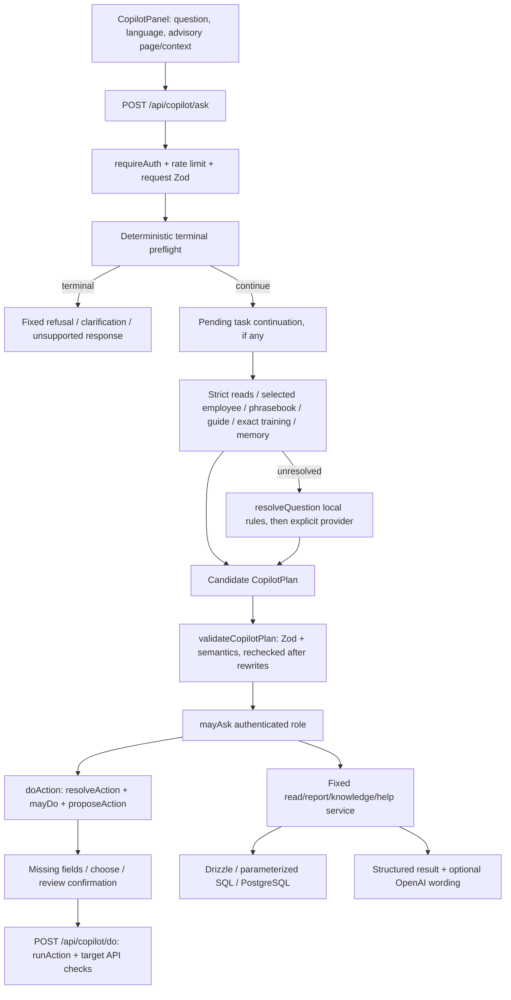
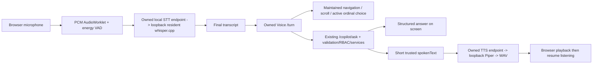

# Current AI, Copilot, Voice, RAG and MCP architecture

Date: 2026-10-22. This describes inspected code, not a proposed replacement. See [baseline](00-current-system-baseline.md) for configuration and [privacy audit](03-privacy-and-pii-audit.md) for data boundaries.

## Text request and trusted execution

Sources: [CopilotPanel.tsx](../../hr-app/src/features/copilot/CopilotPanel.tsx), [shared/copilot.ts](../../shared/src/copilot.ts), [routes/copilot.ts](../../server/src/routes/copilot.ts), [middleware.ts](../../server/src/middleware.ts), [auth/session.ts](../../server/src/auth/session.ts).

The UI sends a question, not SQL. `/ask` accepts 2–500 trimmed characters plus language, path and advisory context. Signed cookies resolve to an unexpired DB session and an active user; the current role is loaded server-side. `askLimit` is 20 requests/hour keyed with the user and the limiter's normal request identity. Context supplied by the browser never grants a permission.

Authentication and request validation also precede terminal replies. Terminal answers contain fixed language and `result: none`, wrapped using the existing answer schema. They are not executable plans and never visit `knowledgeReply`, `resolveAction`, phrasing, an HR executor, or an embedding call on that terminal path. Audit/unanswered-question storage can still occur.

## Actual routing order and abstention

1. `deterministicRoutingOutcome()` checks tightly anchored unsupported/self-pay filters, request-status subsets, ambiguous scope/HR subject, and reviewed complete external requests. It abstains with record/document/page context, previous plans, uncertain pending free-text slots, quotations and compounds. See [routingOutcome.ts](../../server/src/copilot/routingOutcome.ts).
2. An active five-minute task may call **OpenAI-only `continueTask()`** before ordinary classification. It can continue, abandon, skip an optional field, or let a new question proceed.
3. The HTTP route computes strict read/help decisions. High-confidence reads outrank phrasebook and similarity. An abstention skips the older fuzzy/exact shortcuts. Selected-employee UI references are resolved server-side within actor scope; they are not accepted as authority.
4. Phrasebook `lookUp()` uses normalized exact entries plus maintained navigation/job-description prefixes. Guide matches, exact training matches and role-matched accepted instruction memory are other local paths. Memory may pin an action category; dynamic parameters are extracted again.
5. `resolveQuestion()` itself considers maintained help, conservative conversation follow-ups, deterministic read plans and selected existing local training plans before provider selection. Certain protected actions, reports, employee and payroll plans are returned locally. Other local guesses are not universally authoritative when a provider is available.
6. Remaining questions use `questionGenerationProvider(getClient)`. No OpenAI/Ollama automatic fallback exists. Missing OpenAI configuration can use an available local candidate; OpenAI authentication errors have that same limited local recovery. This is local-plan recovery, not cloud-provider failover. Ollama errors are mapped to invalid output or unavailable.
7. Invalid plan shape/semantics stops execution. Other resolution failures may attempt role-scoped knowledge retrieval. A non-terminal `outOfScope` with a non-`unclear` reason may also attempt knowledge; `unclear` may attempt `resolveAction()` and then knowledge. These legacy paths must not be confused with the early terminal outcomes.

Sources: [resolve.ts](../../server/src/copilot/resolve.ts) `resolveQuestion`, [training.ts](../../server/src/copilot/training.ts), [phrasebook.ts](../../server/src/copilot/phrasebook.ts), [conversationTraining.ts](../../server/src/copilot/conversationTraining.ts), [context.ts](../../server/src/copilot/context.ts).

### What local recognition currently covers

Conservative read rules combine operation + ownership/scope + subject + supported period/identifier: self attendance, current leave balance, recent requests/payslips, named employee payroll/overtime, explicit company headcount and department grouping, employee details, team presence, and maintained help. Older local families cover named attendance/payroll reports, some report types/comparisons and Payroll Agent views, salary/payroll lifecycle instructions and familiar commands. Phrasebook/exact/fuzzy training paths are additional mechanisms; they are not all the same confidence standard.

`readPeriods.ts` recognizes today, this week/month/year, last month, last six months, and supported named/numbered calendar months with optional year (2000–2100). Arabic-Indic digits and multiple Arabic month names are handled. It does not invent arbitrary date ranges or `lastWeek`. Non-attendance self executors do not gain period support merely because a parser recognizes one.

Strict rules return `resolved`, `abstain`, or `unmatched`. Abstention is sticky against older similarity shortcuts. Conflicting subjects, ownership, unsupported dates and uncertain person extraction go unresolved. The generic Unicode name grammar permits 1–6 words and supported apostrophe/hyphen punctuation, rejects reserved scope/pronoun terms and uncertain Arabic conjunctions, and never looks up/guesses employee IDs.

### Examples and similarity are not fine-tuning

The 10k JSONL is loaded locally, mapped from 38 source labels, and augmented with supplemental phrases. Source `role`, `tool`, `target`, `parameters` and confirmation hints are not trusted for authorization/execution. Current runtime statistics: 10k usable rows; 193 phrasebook entries; 443 conversation examples.

`relevance()` gives exact normalized matches score 10; otherwise token overlap divided by the geometric token-count mean, containment bonus 0.4, and matching source-role bonus 0.03. `bestExample()` accepts score >=0.4, tie-breaks by ID, and has **no calibrated probability or runner-up margin**. Few-shot selection uses >=0.2 and at most 10 question or 8 action examples. Question examples currently concatenate intent examples before action examples and then truncate. Conversation prompts select up to 6 question or 8 continuation examples. None of these paths updates model weights.

## Model request, extraction and validation

[structured.ts](../../server/src/ai/structured.ts) defines `generateStructured<T>({messages, schema, schemaName, temperature})` returning validated data, provider/model and token usage. For questions the envelope is `{plan: CopilotPlan}`, temperature 0; system text contains the actor's allowed intent descriptions, rules, selected examples and, when present, the previous plan. User text is placed in a marked data block. Entity fields are copied/extracted text or controlled enums; employee resolution happens later.

* OpenAI question adapter: `responses.parse`, `OPENAI_MODEL`, messages as `input`, `zodTextFormat`, and server Zod validation.
* Ollama: native `POST /api/chat`, JSON Schema in `format`, `stream:false`, `think:false`, 120-second abort including body consumption, envelope/JSON/Zod checks. Only Qwen3-tagged models get the extra `/no_think` user-message control; Qwen2.5 does not. Development residency is `keep_alive:30m`. See [ollama.ts](../../server/src/ai/ollama.ts).
* No tool/function-calling loop executes HR operations in this classifier. `doAction` is another structured plan, not an arbitrary LLM tool call. MCP tools are a separate external transport. OpenAI Realtime explicitly configures `tools: []`.

[validatePlan.ts](../../server/src/copilot/validatePlan.ts) rejects calendar period/field mismatch, refusal metadata on executable intents, payroll topics or ranking/report fields on incompatible intents, company payroll with a person, and payroll report types outside `employeeFile`. It does not prove supported filters, required employee identity, complete authorization or all report-type/scope combinations. Plans are checked before and after contextual/legacy rewrites. `routingSource` is deterministic/phrasebook/training/model; `routingRule` uses fixed rule identifiers. Logs contain those codes, not employee field values.

## Permission and service boundary

`mayAsk()` uses [intents.ts](../../server/src/copilot/intents.ts); actions use `mayDo()` through [actions.ts](../../server/src/copilot/actions.ts) and [permissions.ts](../../server/src/permissions.ts). They do not trust a role claimed in user prose. `/do` rechecks permission and dispatches through `runAction()` to existing authenticated APIs using the caller's cookie. `/fill` whitelists declared form fields and creates a proposal through the same service. Most text actions return confirm/choose before execution; navigation/filter/scroll/open-file and mark-notifications-read have explicit auto-execution paths. A UI confirmation is not a separate grant of authority.

Self queries force `actor.id`; team queries use `managerId = actor.id`; payroll reports explicitly require HR/admin. Action employee lookup scopes SQL before matching. Employee report lookup currently fetches up to two global name/number matches and then checks manager ownership before rendering (not SQL prefiltering). Ambiguous employee read matches return no data; action lookups can return choices. Do not describe all these paths as one identical SQL scope mechanism.

[execute.ts](../../server/src/copilot/execute.ts) has fixed query branches; [reports/build.ts](../../server/src/reports/build.ts) and [employeeFile.ts](../../server/src/reports/employeeFile.ts) build reports; [perform.ts](../../server/src/copilot/perform.ts) proposes/runs actions. PostgreSQL access uses Drizzle and `pg` through [db/client.ts](../../server/src/db/client.ts); models do not author SQL.

**Scope limitation:** report `recruitment`/`department` branches do not consume the computed actor scope. `myReport` and manager `generateReport` therefore need subtype-level tests/authorization review. Existing outer gates do not establish safety for those subtypes. No fix or live exploit was attempted.

## Voice: where audio becomes meaning

Frontend: [PersistentVoiceCopilot.tsx](../../hr-app/src/features/copilot/PersistentVoiceCopilot.tsx), [useVoiceProvider.ts](../../hr-app/src/features/copilot/useVoiceProvider.ts), [useLocalVoiceCopilot.ts](../../hr-app/src/features/copilot/useLocalVoiceCopilot.ts), [localVoiceAudio.ts](../../hr-app/src/features/copilot/localVoiceAudio.ts), [localVoiceVad.ts](../../hr-app/src/features/copilot/localVoiceVad.ts). Text-field browser dictation in [useVoiceDictation.ts](../../hr-app/src/features/copilot/useVoiceDictation.ts) is a separate SpeechRecognition path, not the local Voice engine.

Local transport uses normal authenticated HTTP, not WebRTC/WebSocket speech streaming. The browser detects sustained speech and end silence, creates 16kHz mono PCM WAV, and pauses the microphone while STT/HR/TTS/playback runs. It resumes after playback ends; this mode does not provide spoken interruption while the assistant is speaking. Maximum utterance 30 seconds; stalled capture has its own watchdog. It requires microphone permission, a secure browser context (localhost supported), AudioContext/AudioWorklet, and permitted audio playback.

Backend: [routes/voice.ts](../../server/src/routes/voice.ts) exposes `/config`, `/local/session`, owned `/local/session/:sessionId/stt` and `/tts`, `/session/:sessionId/turn`, `/review`, `/confirm`, choice cancellation and close. [local.ts](../../server/src/voice/local.ts) validates WAV/input/response boundaries and talks only to configured loopback worker without proxy/redirect forwarding. [worker.py](../../server/local-voice/worker.py) hosts resident multilingual whisper.cpp (`ggml-small-q5_1.bin`) and CPU Piper (`ar_JO-kareem-low`, `en_US-lessac-low`); [stt_runtime.py](../../server/local-voice/stt_runtime.py) manages a private native subprocess. No local Voice fallback to a cloud audio provider exists.

[localQueue.ts](../../server/src/voice/localQueue.ts) admits one inference request, up to 3 pending, 45-second wait; busy polling is metadata only, not an audio retry. STT backend timeout is 45 seconds/native 40; TTS 15 seconds. Local engine slowness, capture noise, queue wait and model classification latency are separate stages.

The preserved OpenAI path uses [useVoiceCopilot.ts](../../hr-app/src/features/copilot/useVoiceCopilot.ts), browser WebRTC audio plus data-channel events, `/prepare` or `/connect` SDP/ephemeral credentials, and [realtime.ts](../../server/src/voice/realtime.ts). Realtime transcribes audio and speaks supplied trusted text; automatic HR answers/tools are disabled. Final transcripts still return to the same owned `/turn` backend. Unified-to-ephemeral setup fallback is within the same audio provider, not an Ollama/OpenAI text failover.

Voice sessions last 20 minutes; action confirmations/turn cache expire after 5 minutes. Session IDs alone do not grant access. A protected action needs a server-created proposal, visible review, then the exact confirmation phrase. Confirmation execution uses a user-bound operation ID and existing `/copilot/do`. Active ordinal choices refer only to current server proposals. See [session.ts](../../server/src/voice/session.ts) and [idempotency.ts](../../server/src/copilot/idempotency.ts).

Voice skips cosmetic `phraseAnswer()`/report narration; detailed HR records stay on screen and speech normally acknowledges them. Local TTS accepts authenticated text up to 500 characters; it is an audio operation, not an HR query authority. The development mock accepts typed final transcripts and exercises the owned turn/review/confirmation flow while bypassing microphone, real STT, Realtime transport and real audio playback. Diagnostics/mock UI require development mode and explicit `?voiceDebug=1`.

### Speech errors versus understanding errors

* Missing/wrong words, names or period **before** `/turn`: capture/VAD/STT problem.
* Correct transcript, wrong intent/person/period: routing or extraction problem.
* Correct plan, forbidden/no matching scoped employee: permission/identity/service result, not STT failure.
* Correct authorized result, no audible speech: TTS/playback problem.
* Unsupported self-pay period/status filters: capability limitation, not fixable by model accuracy.

Historical local reports show CPU transcription often around 20–30 seconds and Qwen classification tens of seconds/up to its 120-second deadline. These are prior measurements, not new timings in this audit. Fine-tuning the intent model does not directly fix microphone capture, Whisper decoding, speech synthesis, or unsupported services.

## RAG, other AI features and MCP

Company knowledge: [knowledge/service.ts](../../server/src/knowledge/service.ts) chunks documents (1500 characters, 180 overlap, max 60); role audience is enforced in retrieval SQL. With sharing/key enabled it embeds using OpenAI, applies semantic floor 0.34, returns up to 3 documents and optionally writes an answer from cited excerpts. Keyword retrieval and source excerpts remain available when model wording/embeddings are absent. Classification can reach this through `knowledge` or the legacy failure/refusal fallback. Terminal handling deliberately does not.

Job-description retrieval in [ai/retrieval.ts](../../server/src/ai/retrieval.ts) is separate: approved documents, top 3 and similarity floor 0.3, with title matching/suggestions. Job descriptions select OpenAI, then Anthropic, then deterministic outline based on available keys in [ai/index.ts](../../server/src/ai/index.ts), independently of `AI_PROVIDER`. CV analysis, interviews, report narration, payroll-finding explanations and help prose retain their own OpenAI calls. See privacy audit for their actual gates.

[mcp/server.ts](../../server/src/mcp/server.ts) is a separately started stdio server authenticated as a configured real account. It advertises role-filtered capabilities; `hr_ask` invokes `resolveQuestion`, then checks role, calls the generic executor and optional wording. Typed read tools construct plans from [mcp/schemas.ts](../../server/src/mcp/schemas.ts) and call `executeIntent` directly; they do not run the shared semantic boundary/HTTP terminal preflight. Special report/help/knowledge intents handled in the HTTP route are not fully mirrored by the generic executor. MCP is not called by ordinary in-app classification or Realtime tools.

Typed action tools call `proposeAction` and `runAction`; destructive actions require stored five-minute tokens, and `hr_propose`/`hr_confirm` support explicit review. Non-destructive typed action tools can run immediately, unlike the usual text confirmation presentation. The MCP process captures its account at sign-in; write APIs reauthenticate the cookie but direct reads use that captured actor. Role revocation/session expiry parity needs tests. Authorized tool results leave the process to the external MCP client, whose model/storage policy is outside these source files.

## Memory, errors and observability

Browser chat is component state, not a persistent transcript database in `CopilotPanel`. Server pending action, last successful plan and UI references have five-minute in-memory lifetimes, keyed by user. A route change clears prior UI-bound question context. They are neither a general conversation history nor learned model memory. Previous plans and collected action fields can still contain user-supplied PII when included in model prompts.

Persistent [memory.ts](../../server/src/copilot/memory.ts) stores normalized question text, role, intent/action and outcome counters; accepted>0/rejected=0 can be recalled. Returning a read result is treated as weak acceptance, not human-verified label correctness. [unanswered.ts](../../server/src/copilot/unanswered.ts) stores exact failed questions for the HR/admin review inbox. [audit.ts](../../server/src/copilot/audit.ts) instead stores controlled outcome metadata with actor identity, not raw question/results. None is an automatic fine-tuning pipeline.

Provider errors map to configured/unavailable/rate-limited/invalid-output codes; invalid plans do not execute. Missing narration is cosmetic; deterministic results still render. Internal actions return domain errors from existing routes. `Server-Timing` and fixed routing/validation metadata expose latency without HR contents. Some general error handlers stringify upstream errors; that is a privacy review area, not proof of universal log redaction.
